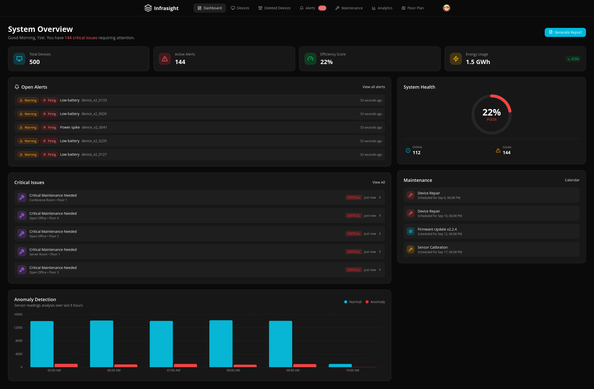
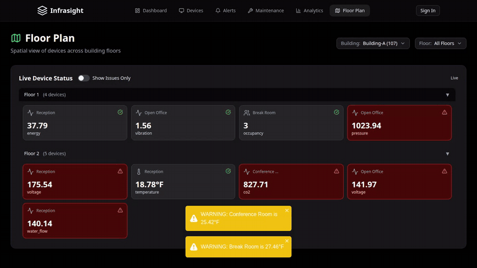
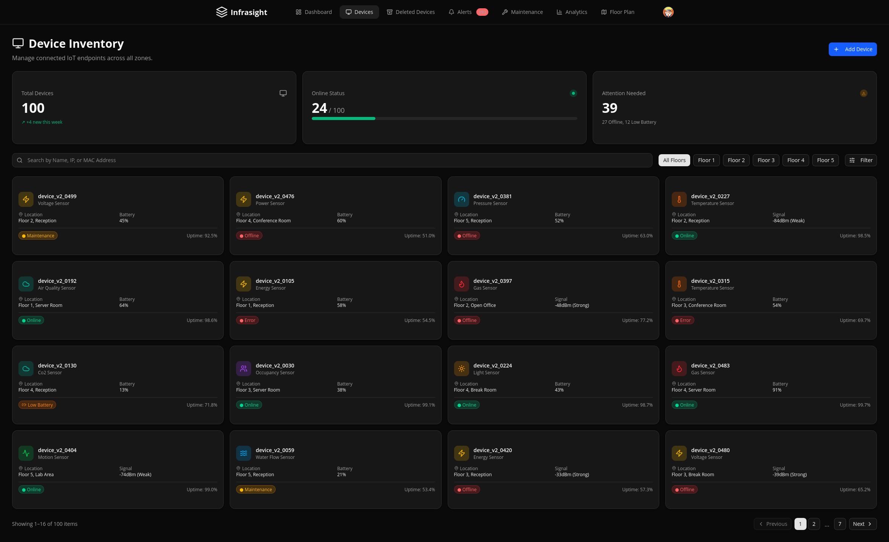
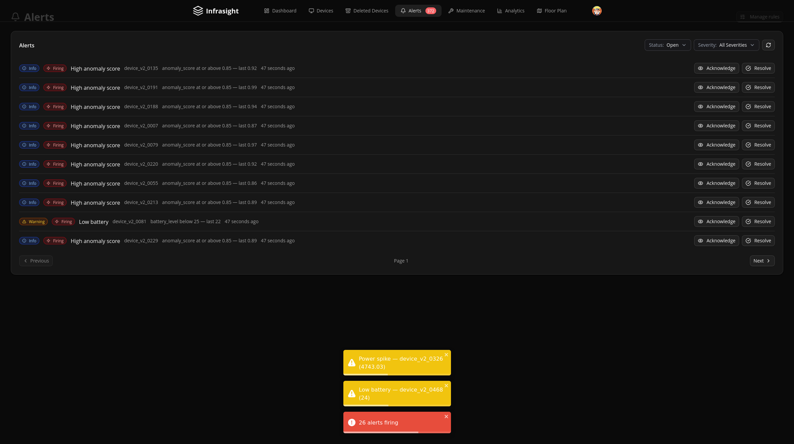
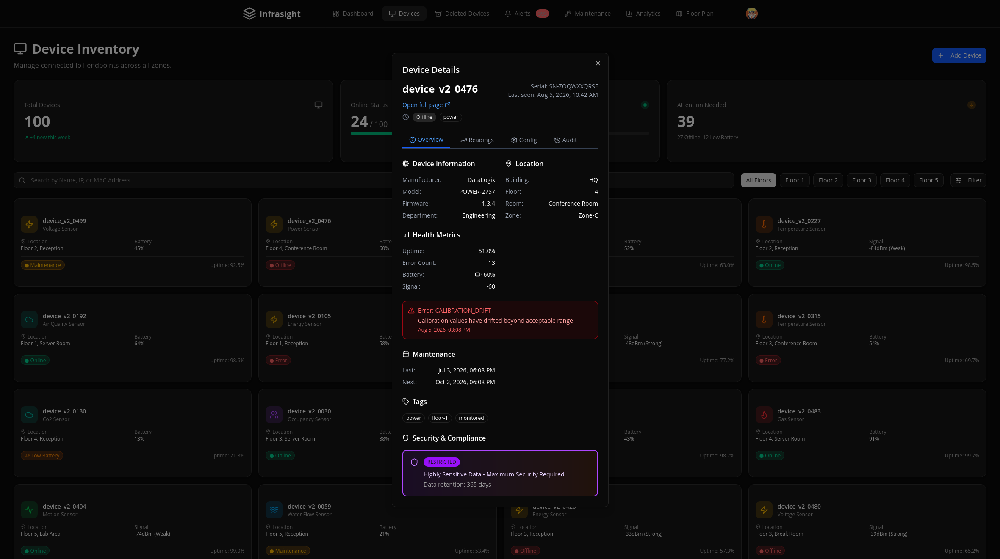
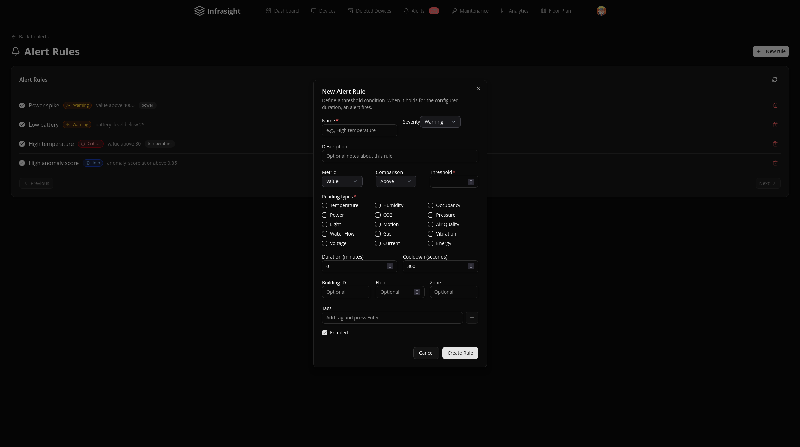
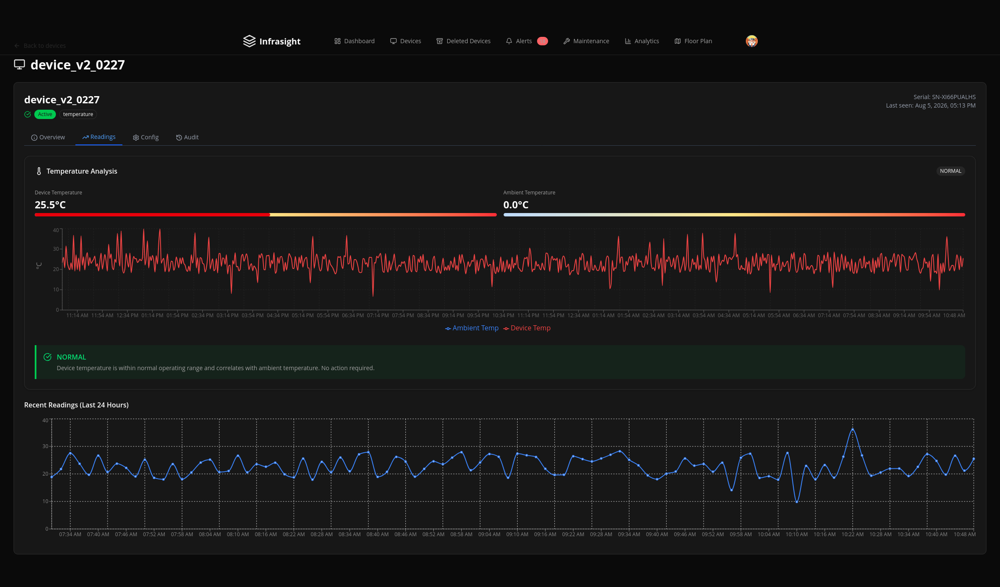
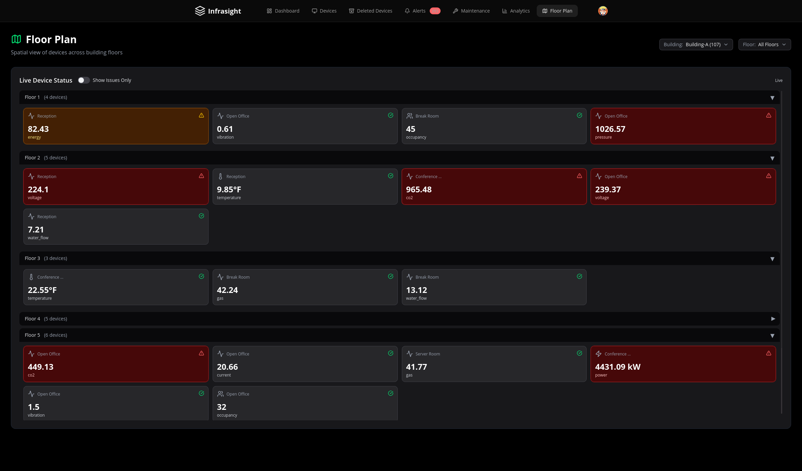

  

<!-- Based on the shared project README at https://github.com/Amadou-dot/Amadou-dot/blob/main/templates/project/README.md -->

# Infrasight

Infrasight helps building operators monitor temperature, air quality, occupancy, and power by room. The floor plan shows the latest readings, while the dashboard flags unusual measurements, open alerts, and upcoming maintenance. The sample fleet defaults to 500 simulated devices. Explore the read-only demo without signing in.

  
  
  
  
  
  

## Highlights

- **Live floor plan.** Select a building and floor to see readings for its devices. The simulator trims each public update to the device ID, measurement type, timestamp, and value, then batches the readings to fit Pusher’s 10 KB event limit. [Floor plan](components/FloorPlan.tsx) · [Reading broadcasts](lib/pusher-readings.ts)
- **Threshold alerts.** A rule can require a reading to stay outside its threshold for a set time. Brief excursions clear before an alert fires. Administrators can acknowledge a firing alert, and the system records whether readings recovered or the device stopped reporting. [Alert evaluation and staleness checks](lib/alerting/) · [Alert lifecycle](models/v2/AlertV2.ts)
- **Sensor history.** MongoDB groups time-series readings by device, measurement type, unit, and source. Each reading stores its own timestamp and quality flags. The collection has a seven-day retention period. [Reading model](models/v2/ReadingV2.ts)
- **Organization access.** Administrators manage devices and alert rules. The channel authorization endpoint signs only the private alerts channel for members of an allowed Clerk organization. When many alerts arrive together, the channel delivers a count by severity. [Role checks](lib/auth/) · [Channel authorization](app/api/pusher/auth/route.ts) · [Alert notifications](lib/alerting/notify.ts)

<strong>More screens</strong> · Devices, alerts, and floor plans

| Device monitoring                                                                                                                | Alerts and floor plans                                                                                                      |
| -------------------------------------------------------------------------------------------------------------------------------- | --------------------------------------------------------------------------------------------------------------------------- |
|                                   |                   |
|   |  |
|  |           |

## Tech stack

| Layer                     | Technology                                                                                                                                                                                                              |
| ------------------------- | ----------------------------------------------------------------------------------------------------------------------------------------------------------------------------------------------------------------------- |
| Application               | [Next.js 16](https://nextjs.org/) App Router and Turbopack, [React 19](https://react.dev/), [TypeScript](https://www.typescriptlang.org/), [Tailwind CSS](https://tailwindcss.com/)                                     |
| Storage                   | [MongoDB](https://www.mongodb.com/) time-series collections with [Mongoose](https://mongoosejs.com/), optional [Redis](https://redis.io/) or [Upstash](https://upstash.com/) for [caching and invalidation](lib/cache/) |
| Client state              | [TanStack Query](https://tanstack.com/query) with a typed API client and query hooks                                                                                                                                    |
| API                       | [Zod](https://zod.dev/) validation, Redis-backed rate limiting, and device health reports in PDF format                                                                                                                 |
| Identity and live updates | [Clerk](https://clerk.com/) organization roles and [Pusher Channels](https://pusher.com/)                                                                                                                               |
| Observability             | [Sentry](https://sentry.io/), structured logs, request tracing, and optional Prometheus metrics                                                                                                                         |

## Documentation

| Guide                                                                                       | Covers                                                                                   |
| ------------------------------------------------------------------------------------------- | ---------------------------------------------------------------------------------------- |
| [Contributing](CONTRIBUTING.md)                                                             | Local setup, sample data, development commands, and checks before opening a pull request |
| [API reference](docs/api-v2.md)                                                             | Device, reading, and analytics endpoints, pagination, and response formats               |
| [Data models](docs/models-v2.md)                                                            | Schemas, indexes, and time-series queries                                                |
| [Environment](docs/environment.md)                                                          | Configuration for authentication, live updates, caching, and monitoring                  |
| [Testing guide](docs/testing-v2.md) · [Jest suites](__tests__/) · [Playwright suites](e2e/) | Unit, integration, and browser tests                                                     |
| [Operational runbook](docs/runbook.md)                                                      | Deployment, monitoring, and incident response                                            |

## License

[MIT](LICENSE) · Built by [Amadou](https://github.com/Amadou-dot)
