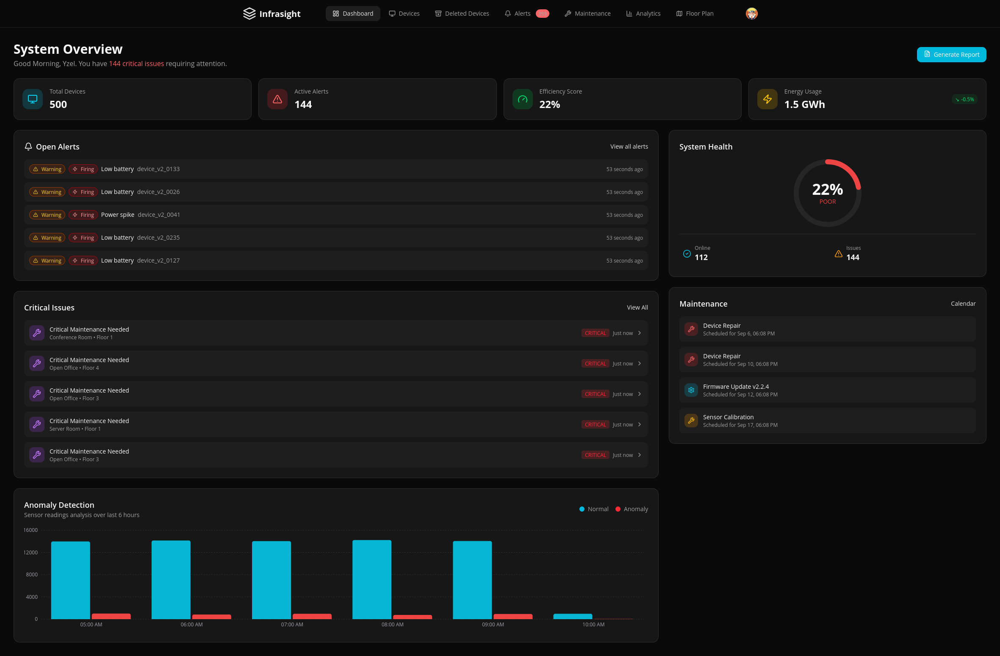
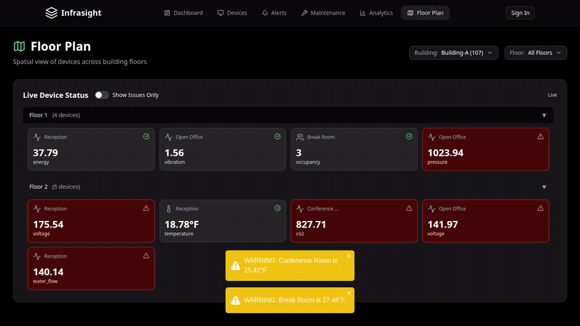
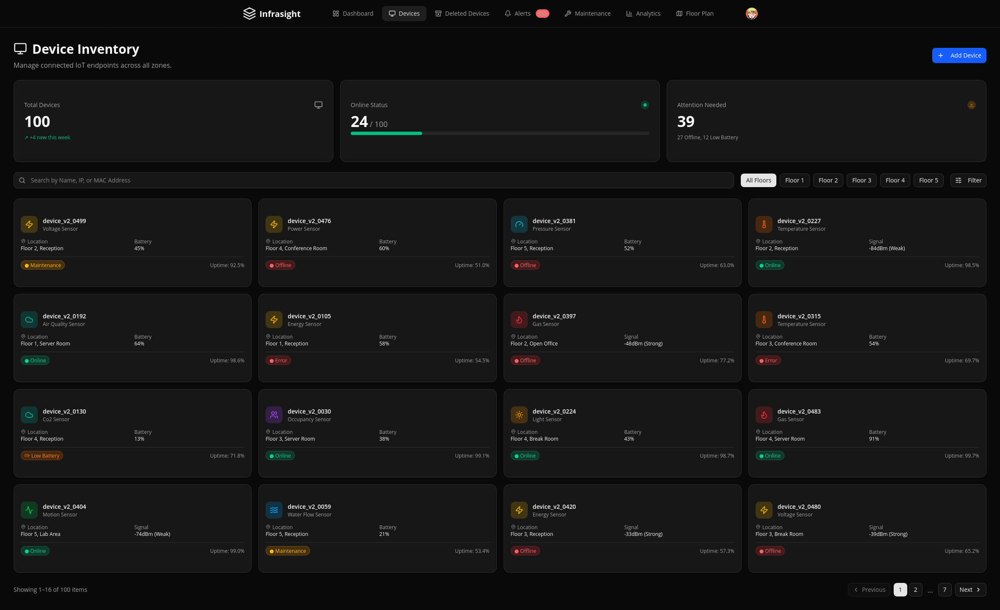
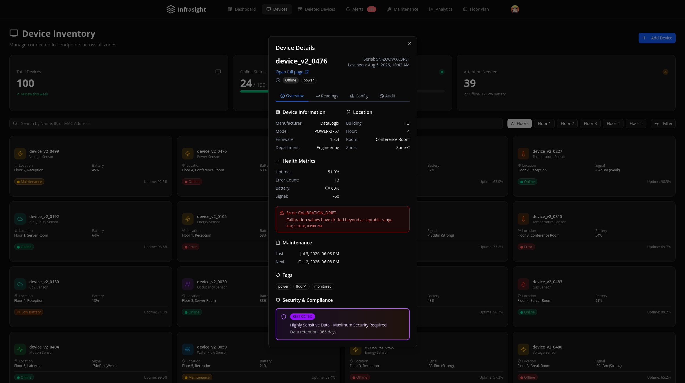
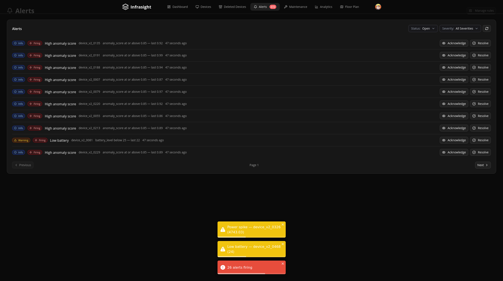
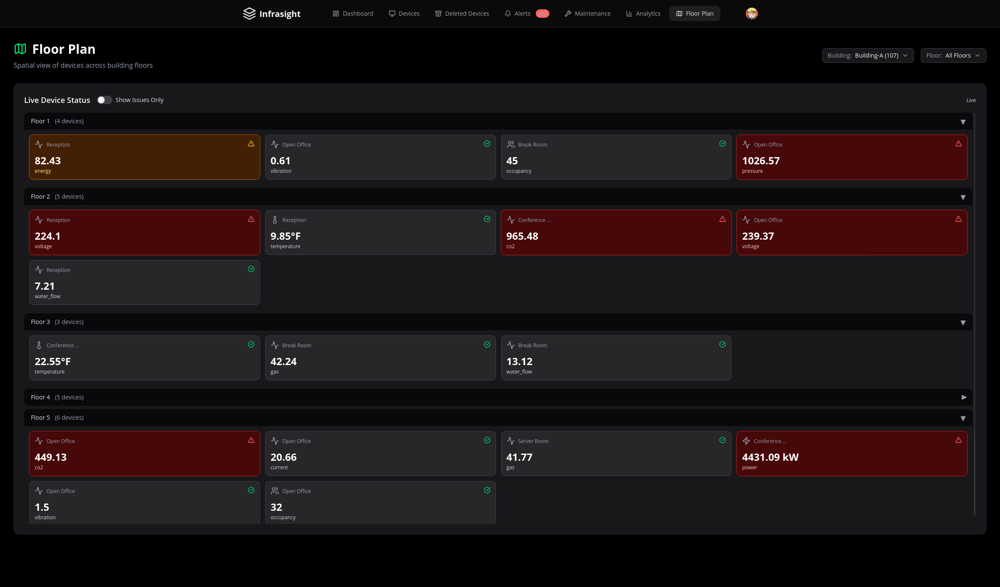
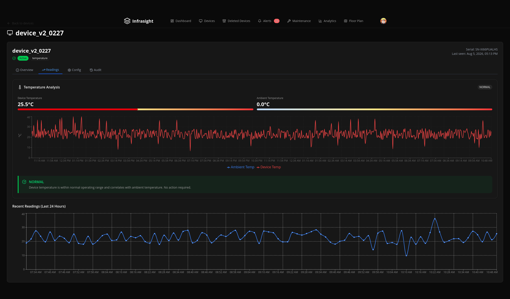
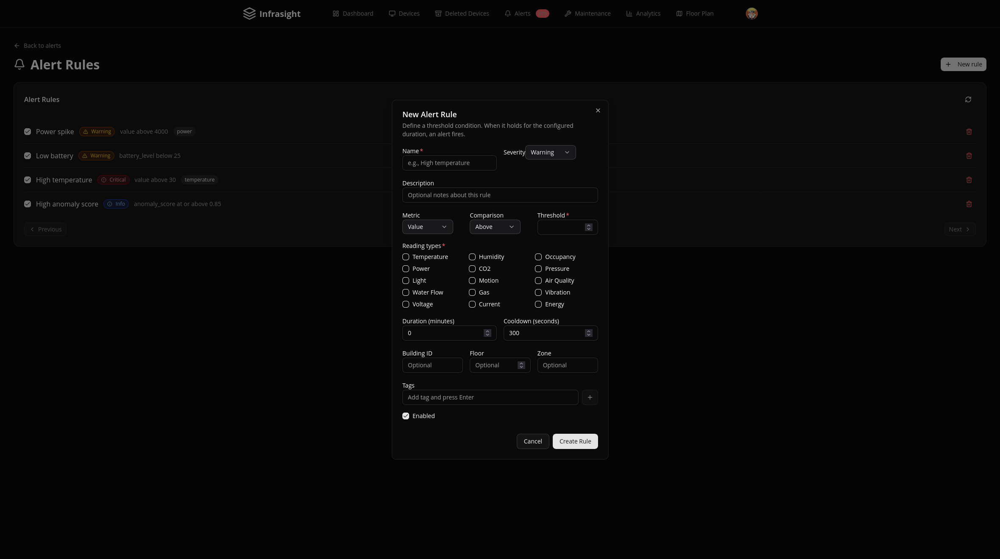

  

  
  
  
  
  
  

Real-time IoT monitoring for building management: 500 sensors across floors and rooms, streamed over WebSockets into a dashboard with threshold alerting, anomaly detection, and predictive maintenance.

**[Try the live demo](https://www.infrasight.org/)** — it's a public, read-only tour. No signup.

Readings arrive live — the floor plan below is receiving them over Pusher, with threshold alerts firing as toasts:

## What's interesting here

- **Timeseries bucketing on low-cardinality metadata.** Readings live in a MongoDB timeseries collection whose bucketing key is a deliberately tiny metadata document (device, type, unit, source) — cardinality discipline the schema comments explain and the 7-day TTL depends on. See [models/v2/ReadingV2.ts](models/v2/ReadingV2.ts).
- **One RBAC gate in front of every mutation.** All writes route through `requireAdmin()` in [lib/auth/](lib/auth/), so the public demo gets write-blocking for free: anonymous visitors receive a synthetic member context and the existing, already-tested gate does the rest.
- **Alerting with a real lifecycle.** Threshold rules are evaluated on the ingest path; episodes move `pending → firing → acknowledged → resolved` through a state machine that deletes never-fired episodes and enforces its invariants at every write ([lib/alerting/](lib/alerting/), [models/v2/AlertV2.ts](models/v2/AlertV2.ts)), with a staleness sweep for devices that silently stop reporting.
- **Realtime that respects transport limits.** Reading broadcasts are trimmed to the wire shape and chunked under Pusher's 10 KB event cap ([lib/pusher-readings.ts](lib/pusher-readings.ts)); alert envelopes degrade to a storm summary instead of flooding ([lib/alerting/notify.ts](lib/alerting/notify.ts)); the private channel's auth endpoint signs an allow-list, not arbitrary channel names ([app/api/pusher/auth/route.ts](app/api/pusher/auth/route.ts)).
- **2,800+ test cases** across unit, integration, and E2E layers ([__tests__/](__tests__/), [e2e/](e2e/)), with coverage thresholds enforced in CI.

<b>More screens</b> — devices, device detail, alerts, floor plan

| | |
| --- | --- |
|  |  |
|  |  |
|  |  |

## Tech stack

| Layer | Technology |
| --- | --- |
| Frontend | [Next.js 16](https://nextjs.org/) (App Router, Turbopack), [React 19](https://react.dev/), [TypeScript](https://www.typescriptlang.org/), [Tailwind CSS](https://tailwindcss.com/) |
| Data | [MongoDB](https://www.mongodb.com/) timeseries via [Mongoose](https://mongoosejs.com/), [Redis](https://redis.io/)/[Upstash](https://upstash.com/) cache-aside with automatic invalidation ([lib/cache/](lib/cache/)) |
| Realtime | [Pusher](https://pusher.com/) — public readings channel + authorized private alerts channel |
| Auth | [Clerk](https://clerk.com/) with organization-based RBAC |
| API | 33 v2 endpoints, [Zod](https://zod.dev/)-validated, rate-limited, with Prometheus metrics and PDF reporting |
| State | [TanStack Query](https://tanstack.com/query) with typed API client and hooks |
| Observability | [Sentry](https://sentry.io/), structured logging, request tracing |

## Documentation

| Document | Covers |
| --- | --- |
| [API Reference](docs/api-v2.md) | All v2 endpoints, request/response contracts |
| [Data Models](docs/models-v2.md) | Schemas, indexes, timeseries constraints |
| [Environment](docs/environment.md) | Every variable, what breaks without it |
| [Testing](docs/testing-v2.md) | Strategy, layers, how to run |
| [Runbook](docs/runbook.md) | Deployment, monitoring, incident response |

## Running it locally

Setup, scripts, project layout, and contribution guidelines live in [CONTRIBUTING.md](CONTRIBUTING.md).

## License

[MIT](LICENSE)

---

Made by <a href="https://github.com/Amadou-dot">Amadou</a>

